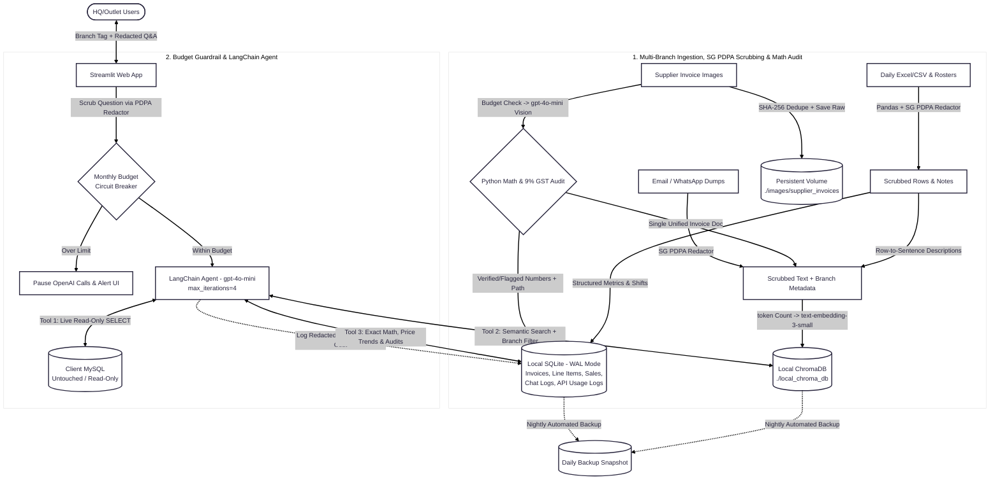

# Kaya Kopi Holdings — Multi-Outlet AI Operations & Audit Architecture

## 1. System Overview

This document outlines the technical architecture for the **Kaya Kopi Multi-Outlet AI Operations & Audit Hub**, built with **Streamlit**, **LangChain / LangGraph**, and **OpenAI** (`gpt-4o-mini` and `text-embedding-3-small`)

---

## 2. End-to-End Architecture Diagram

---

## 3. Storage Strategy & Responsibilities

To guarantee deterministic financial calculations while supporting flexible, unstructured branch documents, storage is divided into three specialized engines:

| Storage Layer | Role & Contents | Why This Engine? |
| :--- | :--- | :--- |
| **MySQL** | **All Business & Financial Data:** • *Existing Client Tables (Read-Only):* `outlets`, `menu_items`, `pos_transactions`, `supplier_purchases` • *New Audited Tables:* `invoices`, `invoice_items`, `daily_branch_summaries` | Vector search is approximate and unsuitable for financial sums or price averages. Storing structured business data in MySQL ensures **100% deterministic math** and enables cross-table joins (e.g., reconciling daily manager CSVs against live POS transactions). |
| **ChromaDB (Local)** | **Unstructured Operational Context:** • Single unified text blocks per supplier invoice • Row-to-sentence descriptions of dynamic branch Excel/CSV files & rosters • Scrubbed WhatsApp & email threads | Branch managers use varying spreadsheet formats and free-text notes (e.g., *"helper on MC"*, *"rainy day"*, *"CNY period"*). ChromaDB provides built-in `outlet_code` metadata filtering and fast semantic retrieval without requiring an external vector server. |
| **SQLite (Local, WAL Mode)** | **Application State & Telemetry:** • LangGraph conversation checkpoints (`SqliteSaver`) for multi-turn chat memory • `api_usage_logs` (OpenAI token counts & SGD costs) • `file_hashes` (SHA-256 deduplication) & `chat_logs` | Isolates fast-changing session checkpoints and internal telemetry from business records. Configured with `PRAGMA journal_mode=WAL` and a 30-second busy timeout to support concurrent multi-branch access smoothly. |
| **Local Disk / Persistent Volume** | **Raw Receipt Archive (`./uploaded_invoices`):** • Original JPG/PNG invoice scans linked via `image_path` in MySQL and ChromaDB | Keeps databases lightweight and fast while allowing Streamlit to display the original scanned receipt (`st.image`) whenever a user inspects an invoice. |

---

## 4. Data Ingestion & Auditing Pipelines

### A. Supplier Tax Invoices (Vision OCR + 9% GST Math Audit)
1. **Deduplication:** Incoming images are hashed using **SHA-256**. If an identical file was already uploaded, processing halts immediately to prevent duplicate records and wasted API spend.
2. **Structured Vision Extraction:** `gpt-4o-mini` extracts the supplier name, GST Registration Number, invoice number, date, `"received"` stamp status, subtotal, GST amount, grand total, and individual line items (`item_name`, `normalized_name`, `quantity`, `unit`, `unit_price`, `line_total`).
3. **Deterministic Python Math Audit:** Before saving to MySQL, Python independently verifies:
   - Each line item (`quantity * unit_price == line_total` within a `$0.05` rounding tolerance).
   - Subtotal accuracy (`SUM(line_total) == printed_subtotal`).
   - **Singapore 9% GST compliance** (`ROUND(computed_subtotal * 0.09, 2) == printed_gst`) and ensures a valid GST Registration Number is present whenever GST is charged.
   - Grand total accuracy (`computed_subtotal + computed_gst == printed_total`).
   - Both **printed** and **computed** figures are saved in MySQL alongside an `audit_status` (`VERIFIED` or `DISCREPANCY`) and detailed `audit_notes`.
4. **Hybrid Indexing:** Header and line-item numbers are written to MySQL for exact spend and unit-price trend queries, while a single unified invoice summary is embedded into ChromaDB (never split across chunks) so invoice context stays intact.

### B. Dynamic Branch Excel/CSV Files & Rosters
1. **Date & Schema Normalization:** Flexible column matching extracts core daily metrics (`Date` converted from `DD/MM/YYYY` to `YYYY-MM-DD`, `Total Sales (SGD)`, `No of Cups`, `Remarks`) into MySQL's `daily_branch_summaries` table when present.
2. **Row-to-Sentence Serialization:** Because every branch manager reports slightly different custom columns, every row is serialized into a descriptive `Header: Value` sentence tagged with `outlet_code` metadata and embedded into ChromaDB.

### C. WhatsApp & Email Dumps
- Pasted chat exports and email threads are scrubbed for PII, chunked into ~1,000-character segments with overlap, tagged with `outlet_code`, and indexed into ChromaDB for operational troubleshooting.

---

## 5. Compliance & Cost Governance

### Singapore PDPA Redaction Layer
Before any user prompt or uploaded file content is sent to OpenAI's API or written to storage, a local Python regex scrubber masks sensitive identifiers:
- **NRIC / FIN Numbers:** `[STFGM]\d{7}[A-Z]` $
ightarrow$ `[REDACTED_NRIC]`
- **Singapore Phone Numbers:** `+65` / 8-digit local numbers $
ightarrow$ `[REDACTED_PHONE]`
- **Email Addresses:** Standard email patterns $
ightarrow$ `[REDACTED_EMAIL]`
- **Bank & Card Numbers:** 10-to-16-digit account sequences $
ightarrow$ `[REDACTED_ACCOUNT]`

### OpenAI Budget Circuit Breaker & Telemetry
- **Exact Usage Tracking:** Every `gpt-4o-mini` call (agent reasoning and Vision OCR) is wrapped in LangChain's `get_openai_callback()`, while `text-embedding-3-small` calls record exact token counts via `tiktoken`.
- **Hard Spending Cap:** Token counts and SGD costs are logged to SQLite (`api_usage_logs`). Before executing any LLM or Vision OCR call, the **Budget Circuit Breaker** checks cumulative monthly spend against the configured SGD cap (e.g., `S$50.00/month`) and automatically pauses API calls if the threshold is reached.
- **Loop Protection:** The LangChain/LangGraph agent enforces `max_iterations=4` to prevent runaway SQL retry loops.

---