# Kaya Kopi proposed ER diagram

This is the target MySQL schema. It combines the legacy data dump exported from client database with parsed client files.

```mermaid
erDiagram
    OUTLETS ||--o{ POS_TRANSACTIONS : "logical outlet-code join"
    MENU_ITEMS ||--o{ POS_TRANSACTIONS : "logical item-id join"

    OUTLETS ||--o{ OUTLET_ALIAS : "has evidenced alias"
    SOURCE_DOCUMENT ||--o{ OUTLET_ALIAS : "supports mapping"

    SOURCE_DOCUMENT ||--o{ DAILY_OUTLET_SUMMARY : "supplies rows"
    OUTLETS ||--o{ DAILY_OUTLET_SUMMARY : "reports"

    SOURCE_DOCUMENT ||--o| STAFF_ROSTER : "supplies workbook"
    STAFF_ROSTER ||--|{ STAFF_ASSIGNMENT : "contains"
    OUTLETS ||--o{ STAFF_ASSIGNMENT : "staffed by"
    STAFF_ASSIGNMENT ||--|{ STAFF_SHIFT : "defines weekly shifts"

    SOURCE_DOCUMENT ||--o| SUPPLIER_INVOICE : "represents scan"
    SUPPLIER ||--o{ SUPPLIER_INVOICE : "issues"
    SUPPLIER ||--o{ SUPPLIER_PURCHASES : "logical supplier-code join"
    SUPPLIER_INVOICE ||--|{ SUPPLIER_INVOICE_ITEM : "contains"
    SUPPLIER_PURCHASES ||--|| PURCHASE_INVOICE_RECONCILIATION : "is assessed"
    SUPPLIER_INVOICE o|--o| PURCHASE_INVOICE_RECONCILIATION : "may match"

    SOURCE_DOCUMENT ||--o{ DOCUMENT_CHUNK : "is split into"
    DOCUMENT_CHUNK ||--o{ DOCUMENT_ENTITY_MENTION : "mentions"
    OUTLETS o|--o{ DOCUMENT_ENTITY_MENTION : "resolves outlet"

    SOURCE_DOCUMENT ||--o{ DATA_QUALITY_ISSUE : "produces"

    OUTLETS {
        INT outlet_id PK
        VARCHAR_10 outlet_code
        VARCHAR_80 outlet_name
        VARCHAR_20 outlet_type
        DATE opened_date
    }

    MENU_ITEMS {
        INT item_id PK
        VARCHAR_60 item_name
        DECIMAL_6_2 base_price
        VARCHAR_20 category
    }

    POS_TRANSACTIONS {
        INT tx_id "legacy non-key"
        VARCHAR_10 outlet_code "logical reference"
        DATETIME tx_time
        INT item_id "logical reference"
        INT qty
        DECIMAL_6_2 unit_price
        DECIMAL_8_2 total
        VARCHAR_12 payment_mode
    }

    SUPPLIER_PURCHASES {
        INT purchase_id PK
        VARCHAR_10 supplier_code
        VARCHAR_60 supplier_name
        VARCHAR_12 purchase_date "legacy raw text"
        VARCHAR_24 invoice_no
        DECIMAL_8_2 total_amount
        VARCHAR_10 gst_treatment
    }

    SUPPLIER {
        BIGINT supplier_id PK
        VARCHAR_10 supplier_code UK
        VARCHAR_120 canonical_name UK
        VARCHAR_30 validation_status
    }

    SOURCE_DOCUMENT {
        BIGINT source_document_id PK
        CHAR_64 source_version_key UK
        VARCHAR_500 source_uri
        CHAR_64 content_sha256
        VARCHAR_40 document_type
        VARCHAR_100 mime_type
        LONGTEXT raw_text "nullable"
        VARCHAR_500 ocr_json_uri "nullable"
        DECIMAL_5_2 mean_ocr_confidence "nullable"
        VARCHAR_30 extraction_status
        DATETIME ingested_at
    }

    OUTLET_ALIAS {
        BIGINT outlet_alias_id PK
        INT outlet_id FK
        BIGINT evidence_document_id FK
        VARCHAR_10 alias_code
        DATE effective_from
        DATE effective_to "nullable"
        VARCHAR_30 validation_status
    }

    DAILY_OUTLET_SUMMARY {
        BIGINT daily_summary_id PK
        VARCHAR_32 record_import_key UK
        BIGINT source_document_id FK
        INT outlet_id FK
        INT source_row_number
        VARCHAR_30 source_locator
        VARCHAR_10 outlet_code_raw
        VARCHAR_20 raw_business_date
        DATE business_date
        VARCHAR_30 raw_sales_amount
        DECIMAL_12_2 sales_amount_sgd "gross takings incl GST"
        VARCHAR_20 raw_reported_volume
        INT reported_volume "receipt count"
        VARCHAR_20 volume_measure "receipts"
        VARCHAR_20 raw_wastage_kg "nullable"
        DECIMAL_10_3 wastage_kg "nullable"
        VARCHAR_255 remarks "nullable"
        VARCHAR_20 weather "nullable"
        VARCHAR_30 validation_status
        TEXT validation_notes "nullable"
    }

    STAFF_ROSTER {
        BIGINT staff_roster_id PK
        BIGINT source_document_id FK, UK
        DATE roster_month
        VARCHAR_30 validation_status
    }

    STAFF_ASSIGNMENT {
        BIGINT staff_assignment_id PK
        VARCHAR_32 assignment_import_key UK
        BIGINT staff_roster_id FK
        INT outlet_id FK
        VARCHAR_32 staff_key
        VARCHAR_160 staff_name "restricted PII"
        VARCHAR_80 role
        VARCHAR_30 raw_hourly_rate
        DECIMAL_8_2 hourly_rate_sgd
        VARCHAR_30 rate_status
        INT source_row_number
        VARCHAR_80 source_locator
    }

    STAFF_SHIFT {
        BIGINT staff_shift_id PK
        VARCHAR_32 shift_import_key UK
        BIGINT staff_assignment_id FK
        VARCHAR_3 day_of_week
        VARCHAR_10 raw_shift_code
        DECIMAL_5_2 paid_hours
        VARCHAR_30 validation_status
    }

    SUPPLIER_INVOICE {
        BIGINT supplier_invoice_id PK
        BIGINT source_document_id FK, UK
        INT supplier_purchase_id FK, UK "nullable reviewed match"
        VARCHAR_24 invoice_number
        VARCHAR_120 supplier_name
        VARCHAR_255 supplier_address
        VARCHAR_30 gst_registration_number
        DATE invoice_date
        VARCHAR_255 bill_to
        DECIMAL_12_2 subtotal
        DECIMAL_5_2 gst_rate_percent
        DECIMAL_12_2 gst_amount
        DECIMAL_12_2 total_amount
        VARCHAR_80 payment_terms "nullable"
        VARCHAR_120 received_condition "nullable"
        DECIMAL_5_2 mean_ocr_confidence "query convenience"
        BOOLEAN arithmetic_valid
        VARCHAR_30 extraction_status
        TEXT review_notes "nullable"
    }

    SUPPLIER_INVOICE_ITEM {
        BIGINT supplier_invoice_item_id PK
        BIGINT supplier_invoice_id FK
        INT line_number
        VARCHAR_255 description
        DECIMAL_12_3 quantity
        DECIMAL_12_4 unit_price
        DECIMAL_12_2 amount
        DECIMAL_5_2 mean_field_confidence
        BOOLEAN line_total_valid
        VARCHAR_30 extraction_status
        TEXT review_notes "nullable"
    }

    PURCHASE_INVOICE_RECONCILIATION {
        BIGINT reconciliation_id PK
        INT supplier_purchase_id FK, UK
        BIGINT supplier_invoice_id FK, UK "nullable"
        VARCHAR_30 reconciliation_status
        VARCHAR_50 match_method "nullable"
        DECIMAL_12_2 legacy_subtotal_sgd
        DECIMAL_12_2 scanned_subtotal_sgd "nullable"
        DECIMAL_12_2 subtotal_difference_sgd "nullable"
        VARCHAR_30 validation_status
        DATETIME reconciled_at
    }

    DOCUMENT_CHUNK {
        BIGINT document_chunk_id PK
        VARCHAR_32 chunk_import_key UK
        BIGINT source_document_id FK
        VARCHAR_30 source_type
        DATETIME occurred_at "nullable"
        VARCHAR_160 author "nullable"
        VARCHAR_255 title "nullable"
        LONGTEXT chunk_text
        VARCHAR_60 source_locator
        VARCHAR_255 embedding_ref "nullable"
    }

    DOCUMENT_ENTITY_MENTION {
        BIGINT mention_id PK
        BIGINT document_chunk_id FK
        INT resolved_outlet_id FK "nullable"
        VARCHAR_20 entity_type
        VARCHAR_160 mention_text
        VARCHAR_160 canonical_key
        VARCHAR_30 resolution_status
    }

    DATA_QUALITY_ISSUE {
        BIGINT issue_id PK
        VARCHAR_32 issue_import_key UK
        BIGINT source_document_id FK
        VARCHAR_40 record_type
        VARCHAR_64 record_key "nullable"
        VARCHAR_60 source_locator "nullable"
        VARCHAR_60 rule_code
        VARCHAR_20 severity
        TEXT details
        VARCHAR_30 resolution_status
        DATETIME detected_at
    }
```

## Parsed dataset mapping

| Source | Tables |
|---|---|
| Daily CSVs | `DAILY_OUTLET_SUMMARY` |
| Staff roster | `STAFF_ROSTER`, `STAFF_ASSIGNMENT`, `STAFF_SHIFT` |
| Invoice scans | `SUPPLIER_INVOICE`, `SUPPLIER_INVOICE_ITEM` |
| Email and WhatsApp | `DOCUMENT_CHUNK`, `DOCUMENT_ENTITY_MENTION` |
| Validation results | `DATA_QUALITY_ISSUE` |

## Key rules

- Keep the four legacy tables unchanged.
- Keep source paths and row references for citations.
- Map `AMK-3A` to `AMK-03` only for its valid period.
- Daily summaries are the main source for sales and receipt counts.
- The POS dump is partial and is not complete revenue data.
- Missing daily reports are unknown, not zero.
- Scanned invoices are the main source for supplier costs.
- Keep unmatched purchases and invoices for review.
