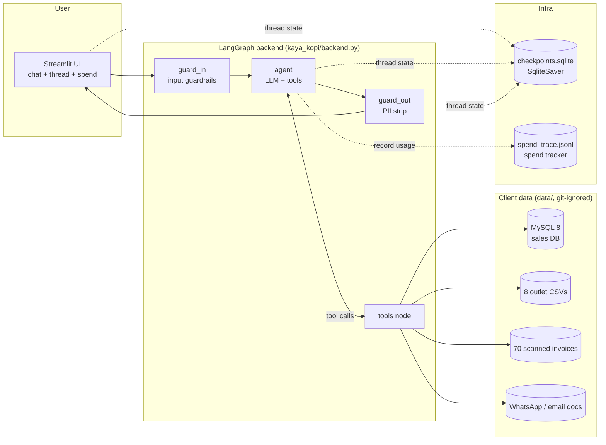
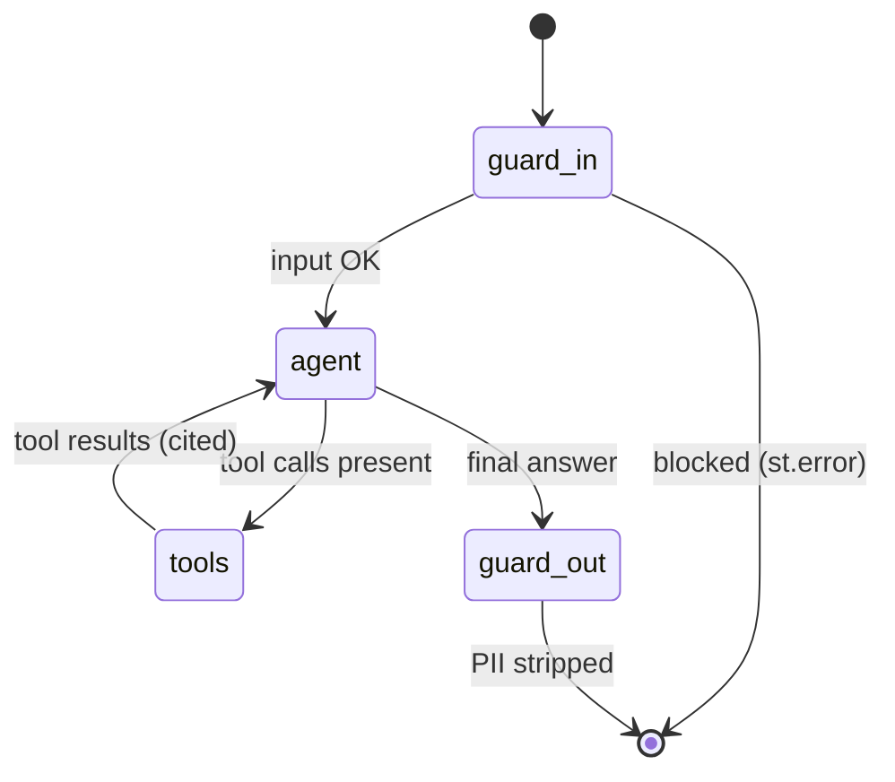

# Kaya Kopi Ops Copilot — Architecture

## 1. System overview

## 2. Agent loop (LangGraph)

## 3. Design decisions

| Decision | Why |
|---|---|
| Tools return **JSON with a `source` field** | Citations are structural, not hoped-for; the LLM is told to copy the `source` into answers (rubric box 2) |
| Tools **never raise, never invent** — they return `{"status":"error", ...}` | Rubric box 4: honest refusal beats a wrong number; `evals.py` R-cases check this |
| `guard_in` / `guard_out` are **graph nodes**, not middleware | Rubric box 3: guardrails are *in code* and visible in the graph diagram the panel can see |
| **SqliteSaver checkpointer** on every run | Rubric box 5: conversation survives a restart; thread id shown in UI |
| **SpendTracker** wraps every LLM call → JSONL | Rubric box 7: budget is a hard cap per README rule 3; sidebar shows live totals |
| `evals.py` = 20+ fixed cases (answerable / refuse / injection / PII) | Rubric box 8; run before every demo |
| HITL (`interrupt()` / `Command(resume=...)`) | Rubric box 6 — wired in Phase B for destructive/confirm actions |
| MySQL via **PyMySQL** against the docker-compose instance (root/capstone, port 3306) | Matches repo `docker-compose.yml`; no new infra |
| Invoice OCR via tesseract (`data/invoices/`) | CP2 requires ≥2 source types incl. images |
| Docs retrieval via FAISS (NB 05 pattern) | WhatsApp/email docs; per-thread index |

## 4. Data flow for a typical question

> "Which supplier raised prices the most?"

1. `guard_in` checks the input (injection patterns, length)
2. `agent` (LLM) decides: `ocr_invoice` + `query_sales_db` tool calls
3. `tools` node runs them → each returns JSON with `source`
4. `agent` composes the answer **citing** `ocr:INV-0042` etc.
5. `guard_out` strips PII; UI streams it; `SpendTracker` logs the call
6. Everything is checkpointed under the thread id → resume any time

## 5. Failure modes we handle

- **No data / not loaded** → tools return error JSON → honest refusal (tested by eval R-cases)
- **LLM hallucination pressure** → system prompt forbids memory answers; citations required
- **Prompt injection** → `guard_in` blocks; `I01` eval case
- **PII leak** → `guard_out` redacts NRIC/email/phone; `R03` eval case
- **Budget burn** → spend tracker caps visibility; JSONL trace is auditable
- **Crash mid-conversation** → SqliteSaver restores state; `thread_id` is stable
