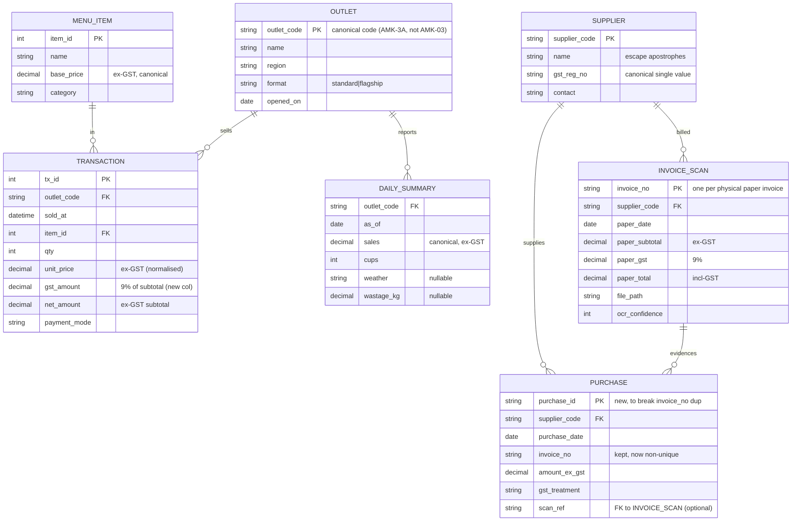

# Team 1 (Kaya Kopi) — ER diagram (cleaned target schema)

Mermaid (renders on GitHub / Mermaid Live Editor). This is the **target** schema we
propose after cleaning; deltas from the raw `kayakopi_pos.sql` are noted below.

## Deltas vs the raw schema (what cleaning changes)

1. **`outlet_code` canonicalised** — `AMK-03` rows are remapped to `AMK-3A` (renamed
   18 May 2026, per email `2026-05-18_outlet_rename.txt`). Raw data keeps both codes.
2. **`TRANSACTION.unit_price` forced ex-GST** — GST-inclusive rows (`base × 1.35`) are
   divided by 1.35; a new `gst_amount` column carries the 9% explicitly. Raw data mixes
   both bases.
3. **`PURCHASE` gets a surrogate `purchase_id`** — raw data has a duplicate `invoice_no`
   (`INV-042509-752`) so `invoice_no` can no longer be a key; it's demoted to a plain
   attribute.
4. **`INVOICE_SCAN` table added** — one row per physical paper invoice (69), holding the
   GST-inclusive `paper_total`. This is the reconciliation source against `PURCHASE`.
5. **`gst_reg_no` single canonical value per supplier** — raw invoices show conflicting
   reg numbers for the same supplier.
6. **`DAILY_SUMMARY` unified** — the 8 heterogeneous outlet CSVs (4 different header
   styles, 2 date formats) are normalised into one table with nullable `weather` /
   `wastage_kg`.
